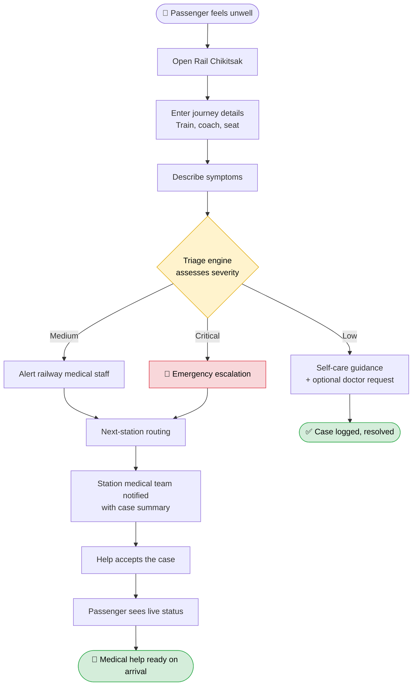
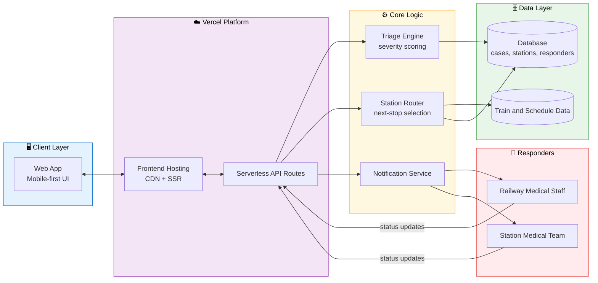
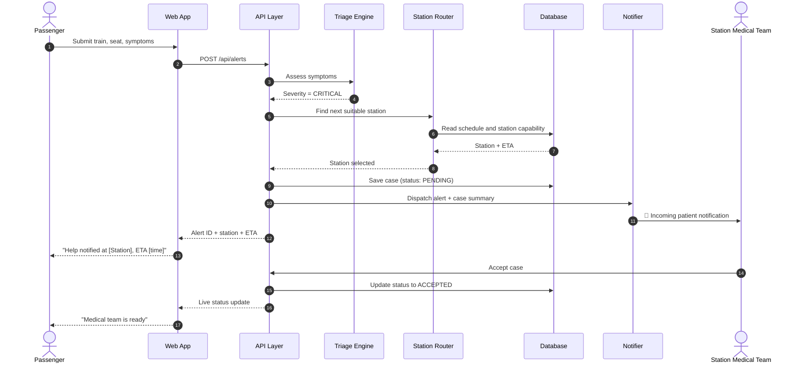
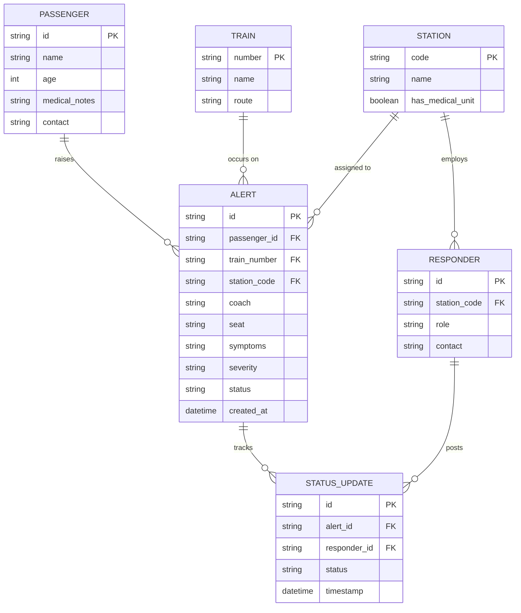
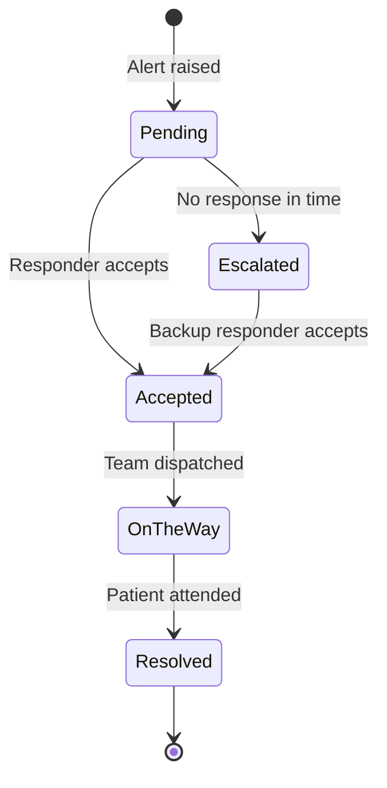
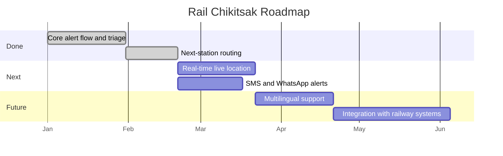

<div align="center">

# 🚆 Rail Chikitsak

### Medical help for train passengers, one tap away.

*When a passenger falls sick between stations, every minute counts. Rail Chikitsak connects them to help before the next platform.*

[](https://rail-project-main.vercel.app)


[🌐 Live App](https://rail-project-main.vercel.app) · [🎥 Demo Video](#) · [📊 Pitch Deck](#)

</div>

---

## 📖 Table of Contents

1. [The Problem](#-the-problem)
2. [Our Solution](#-our-solution)
3. [Features](#-features)
4. [User Workflow](#-user-workflow)
5. [System Architecture](#-system-architecture)
6. [Request Sequence](#-request-sequence)
7. [Data Model](#-data-model)
8. [Tech Stack](#-tech-stack)
9. [Getting Started](#-getting-started)
10. [Project Structure](#-project-structure)
11. [Challenges and Learnings](#-challenges-and-learnings)
12. [Roadmap](#-roadmap)
13. [Team](#-team)

---

## 🚨 The Problem

Indian Railways carries millions of passengers every day, many on journeys of 12 hours or more. A medical emergency on a moving train is a uniquely hard situation:

- **No clear point of contact.** Passengers don't know whom to call or what number to dial.
- **Information gets lost.** Coach, seat, symptoms and medical history are explained again and again to different people.
- **Help arrives late.** Doctors and ambulances can only be arranged once someone at the next station knows to expect them.

## 💡 Our Solution

**Rail Chikitsak** (*chikitsak* means "physician") is a web app that turns a stressful, confusing moment into a structured, fast process.

A passenger or a fellow traveller raises an alert with their journey details and symptoms. The system checks how urgent the situation is, then routes the case to the right responders and the **next suitable station** so that medical help is waiting when the train arrives.

> **In one line:** report symptoms, get triaged, get help at the next stop.

---

## ✨ Features

| | Feature | What it does |
|---|---|---|
| 🆘 | **One-tap emergency alert** | Raise a request in seconds with minimal typing, built for panic situations. |
| 🩺 | **Symptom triage** | Classifies each case as low, medium or critical so responders know where to focus. |
| 🚉 | **Next-station routing** | Picks the upcoming station best placed to receive the patient. |
| 📋 | **Shareable case summary** | Journey details, symptoms and history in one view, so nobody has to repeat themselves. |
| 📡 | **Live status tracking** | The passenger sees whether help has been notified, accepted, or is on the way. |
| 📱 | **Mobile-first, lightweight UI** | Works on a small phone screen and a weak connection. |

> ✏️ *Edit this table to match what your build actually does.*

---

## 🔄 User Workflow

The journey from "someone feels unwell" to "help is waiting on the platform":



---

## 🏗️ System Architecture

A clean three-layer design: a fast client, a stateless API layer that holds the business logic, and managed data and notification services.



### Design principles

- **Stateless API.** Each request carries what it needs, so the app scales on serverless without session headaches.
- **Triage separate from routing.** Each can be improved or swapped (rules today, ML later) without touching the other.
- **Responder-first notifications.** The case summary is delivered pre-packaged, so responders act instead of asking questions.

---

## 🔁 Request Sequence

What happens, step by step, when a critical alert is raised:



---

## 🗃️ Data Model



### Alert lifecycle



---

## 🧰 Tech Stack

| Layer | Technology |
|---|---|
| **Frontend** | `[React / Next.js]`, `[Tailwind CSS]` |
| **Backend** | `[Serverless API routes / Node.js]` |
| **Database** | `[MongoDB / Supabase / Firebase]` |
| **Notifications** | `[SMS / WhatsApp / Email provider]` |
| **Hosting and CI/CD** | Vercel |

> ✏️ *Replace the bracketed items with your real stack.*

---

## 🚀 Getting Started

### Prerequisites

- Node.js 18 or newer
- npm, yarn or pnpm
- Git

### Installation

```bash
# 1. Clone the repository
git clone https://github.com/Akshat19G/Rail-Project-Main.git

# 2. Enter the app directory
cd Rail-Project-Main/rail-chikitsak

# 3. Install dependencies
npm install

# 4. Start the development server
npm run dev
```

Open **http://localhost:3000** in your browser.

### Environment variables

Create a `.env` file in `rail-chikitsak/`:

```env
# Add whatever your project needs, for example:
DATABASE_URL=your_database_url
NOTIFICATION_API_KEY=your_key_here
```

### Production build

```bash
npm run build
npm start
```

---

## 📁 Project Structure

```
Rail-Project-Main/
├── rail-chikitsak/          # Main application
│   ├── src/ (or app/)       # Pages, components, API routes
│   ├── public/              # Static assets
│   └── package.json
├── .gitignore
└── README.md
```

---

## 🧗 Challenges and Learnings

- **Designing for panic.** The first version asked too many questions. We cut the form down to the few fields that actually change the outcome.
- **Triage without being a doctor.** We deliberately framed the tool as a routing and alerting aid, never a diagnosis, and kept escalation conservative.
- **[Add your own]**: a real bug, a trade-off, or a decision you'd make differently.

---

## 🗺️ Roadmap



- [ ] Real-time location tracking
- [ ] SMS and WhatsApp notifications for low-connectivity passengers
- [ ] Hindi and regional language support
- [ ] Teleconsultation with an on-call doctor
- [ ] Analytics dashboard for railway authorities

---

## ⚠️ Disclaimer

Rail Chikitsak is a **hackathon prototype**. It is not a medical device and does not provide diagnosis or treatment. In a real emergency, contact railway helpline **139** or national emergency services **112**.

---

## 👥 Team


| Name | Role | Links |
|---|---|---|
| **Akshat Srivastava** | Team Leader | [GitHub](https://github.com/Akshat19G) |
| **Harsh Mudiya** | Team Member | — |
| **Anisha Singh** | Team Member | — |
| **Gauri Borhade** | Team Member | — |
| **Ansh** | Team Member | — |
| **Kaushal Bhalerao** | Team Member | — |

Built for **[Hackathon Name]**, 2026.

---

<div align="center">

**If this project helped or inspired you, give it a ⭐**

*Made with ☕ and a lot of late nights.*

</div>
